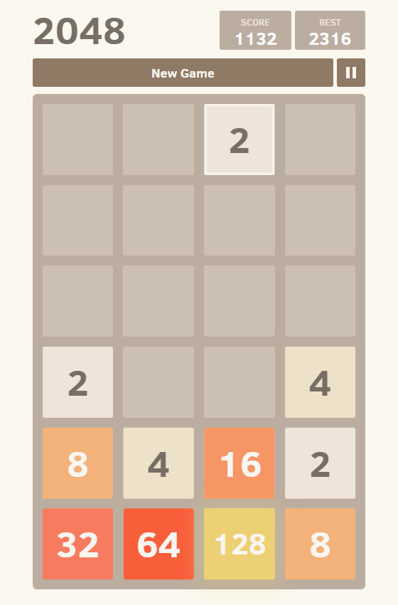

# 2048, with falling tiles
A version of [2048](https://github.com/gabrielecirulli/2048) in which the tiles fall. One tile at a time comes in at the top of the board and falls by itself. You steer it, drop it, and merge tiles with the same number until you make the 2048 tile.

[Play it here!](https://yhu9.github.io/2048/) The code is at [github.com/yhu9/2048](https://github.com/yhu9/2048).

<p align="center">
  
</p>

## How to play
The board has 4 columns and 6 rows, and starts empty.

### The falling tile
- A new tile comes in at a free space of the top row, picked at random. It is a 2 nine times out of ten, and a 4 otherwise.
- Every three quarters of a second it falls one space.
- If the space below it holds a tile with the same number, the two merge into one tile with twice the number. That number is added to your score, and the merged tile has landed.
- If the space below it holds a different tile, or it is at the bottom of the board, it lands where it is.
- As soon as a tile has landed, the next one comes in.

The clock only moves the falling tile. Tiles that have landed stay where they are until you move them.

### Controls
| Key | What it does |
| --- | --- |
| **Left** and **right** (arrow keys, `A` and `D`, or `H` and `L`) | First every landed tile slides as far as it can go that way, and landed tiles with the same number that meet merge. Then the falling tile moves one space that way, if the space is free. If the space holds a tile with the same number, the two merge and the merged tile has landed. |
| **Down** (arrow key, `S` or `J`) | Every tile drops as far down as it can go, the falling tile too, and tiles with the same number that meet merge. The falling tile has then landed. |
| **Up** | Nothing: tiles only go down. |
| `P` | Pauses the game. Press it again to go on. |
| `R` | Starts a new game. |

On a touch screen, swipe left, right or down on the board.

Two details of a move:

- When the landed tiles slide left or right, the falling tile is in their way. They can't pass it or merge with it.
- A tile merges once per move. Two tiles that have just merged don't merge again until the next move or tick.

### When the top row is full
A tile that lands when the top row has no free space is not followed by a new one, but the game goes on. You can still move the landed tiles left, right and down. As soon as a move frees a space in the top row, the next tile comes in.

### Winning and losing
- You win when you make a 2048 tile. Choose **Keep going** to play on for a higher score.
- The game is over when the top row is full and no move left, right or down would move or merge a tile.

### Pausing
Press `P`, or the pause button at the top right corner of the board. While the game is paused nothing moves, no tile comes in and the keys do nothing. The button shows a play icon; press it or `P` again to go on. The next tile step comes a full three quarters of a second later.

### Saved games and best scores
The game is saved in your browser after every step of the clock and every move, so closing or reloading the page goes on where you left off. A pause isn't saved: a reloaded game is running. The best score is kept too.

## How it differs from the original 2048
| | Original | This version |
| --- | --- | --- |
| Board | 4 columns and 4 rows | 4 columns and 6 rows |
| New tiles | Two at the start, then one anywhere on the board after every move | None at the start, then one at a time in the top row, falling by itself |
| Moves | Up, down, left and right slide every tile | Left and right slide the landed tiles and steer the falling one, down drops everything, up does nothing |
| Time | None | The falling tile moves every three quarters of a second, and the game can be paused |
| Game over | No move is left | The top row is full and no move is left |

## Board sizes
The game is played on 4 columns and 6 rows, set by `DEFAULT_BOARD_SIZE` in `js/board_size.js`. The code works on any board the stylesheet has tile positions for, which is up to 8 columns and 6 rows. Each board size keeps its own best score, and a saved game is loaded on the board it was saved with.

The board is sized to fit the window. In a wide window it is as tall as the window and in the middle of it, with the title, the scores, the New Game button and the instructions in the middle of the space at its left. In a narrow window, as in the screenshot, the title, the scores and the New Game button are above the board, and the instructions are below it. The pause button is always at the board's top right corner.

## Playing the game locally
The game is written as ES modules, which browsers only load from a web server, so opening `index.html` straight from disk doesn't work. Get the code and serve the folder instead, for example with Python:

```sh
git clone https://github.com/yhu9/2048.git
cd 2048
python3 -m http.server 8000
```

Then open http://localhost:8000 in a current version of Chrome, Firefox, Safari or Edge.

## Running the tests
The tests need [Node.js](https://nodejs.org/) 18 or later. Install the test dependencies once, then run the suite:

```sh
npm ci
npm test
```

## Changing the styles
`style/main.css` is compiled from `style/main.scss` with [Sass](https://sass-lang.com/), so change the `.scss` file and compile it again:

```sh
npx sass --no-source-map style/main.scss style/main.css
```

## Contributing
Changes and improvements are more than welcome! Feel free to fork [yhu9/2048](https://github.com/yhu9/2048) and open a pull request. Please make your changes in a specific branch and request to pull into `master`! If you can, please make sure the game fully works before sending the PR, as that will help speed up the process.

You can find the same information in the [contributing guide.](https://github.com/yhu9/2048/blob/master/CONTRIBUTING.md)

## Credits
This is a fork of [2048 by Gabriele Cirulli](https://github.com/gabrielecirulli/2048), which you can [play here](http://gabrielecirulli.github.io/2048/) and which also has official apps on the [Play Store](https://play.google.com/store/apps/details?id=com.gabrielecirulli.app2048) and the [App Store](https://itunes.apple.com/us/app/2048-by-gabriele-cirulli/id868076805). The original is a small clone of [1024](https://play.google.com/store/apps/details?id=com.veewo.a1024), based on [Saming's 2048](http://saming.fr/p/2048/) (also a clone), and was indirectly inspired by [Threes](https://asherv.com/threes/).

[Anna Harren](https://github.com/iirelu/) and [sigod](https://github.com/sigod) maintain the original repository. Other notable contributors to it:

 - [TimPetricola](https://github.com/TimPetricola) added best score storage
 - [chrisprice](https://github.com/chrisprice) added custom code for swipe handling on mobile
 - [marcingajda](https://github.com/marcingajda) made swipes work on Windows Phone
 - [mgarciaisaia](https://github.com/mgarciaisaia) added support for Android 2.3

Many thanks to [rayhaanj](https://github.com/rayhaanj), [Mechazawa](https://github.com/Mechazawa), [grant](https://github.com/grant), [remram44](https://github.com/remram44) and [ghoullier](https://github.com/ghoullier) for the many other good contributions.

If you enjoy the game and feel like buying its original author a coffee, donations go to Gabriele Cirulli's BTC address: `1Ec6onfsQmoP9kkL3zkpB6c5sA4PVcXU2i`.

## License
2048 is licensed under the [MIT license.](https://github.com/yhu9/2048/blob/master/LICENSE.txt)
